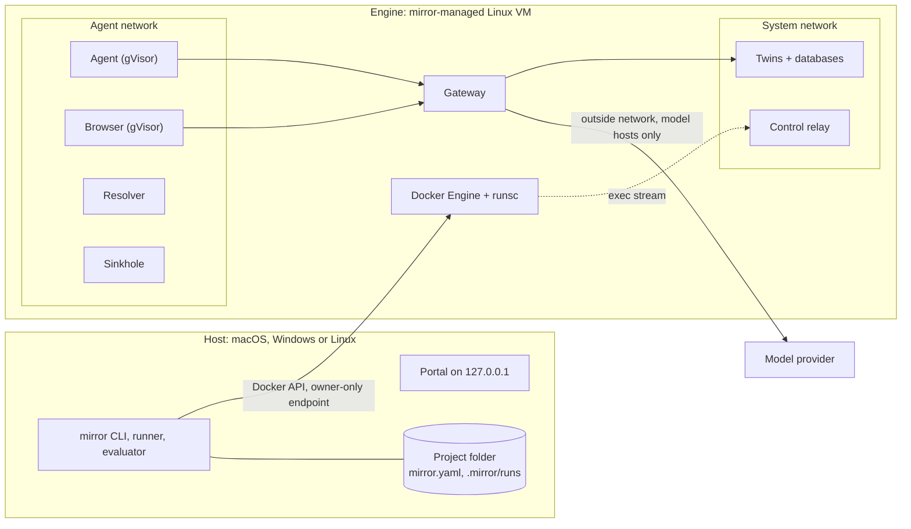

# 0002. All containers run in a mirror-managed Linux VM, the engine

Status: Accepted (owner) · Date: 2026-11-22 · Milestone: M0.5

## Context

The sandbox needs Linux: Docker Engine, internal bridge networks, nftables and gVisor (`runsc`). macOS and Windows only run Linux containers inside a Linux VM. The usual way to get one is Docker Desktop (or OrbStack, Colima, Podman, Rancher Desktop), but each has problems for this product:

- **No gVisor.** Docker Desktop's VM is locked down; you cannot install a container runtime in it.
- **Kernel names that give the test away.** Docker Desktop's kernel reports itself as `…-linuxkit`, OrbStack's as `…-orbstack`, WSL's as `…-microsoft-standard-WSL2`. A container without gVisor sees this in `uname -r` and `/proc/version`. (Measured on the owner's Mac: `6.12.67-linuxkit`.)
- **Hidden routes to the host.** `host.docker.internal`, file sharing of the user's home folder, automatic port forwarding and VPN passthrough are all on by default and all reachable from containers.
- **Licensing.** Docker Desktop needs a paid subscription in companies above 250 employees or $10M revenue, and those companies are the target users.
- **Shared with everything else.** A user's own engine also runs their other containers, so a sandbox escape lands in an environment holding unrelated work and credentials.

The product spec already calls for "a gVisor-class sandbox inside a lightweight VM".

## Decision

1. **The engine.** The mirror creates and manages its own Linux VM, called the engine, on every host. It runs Docker Engine with Compose, gVisor registered as a runtime, nftables rules from 0004, and nothing else. One engine per host user account, shared by that user's mirror projects; each world is its own Compose project with its own networks.

2. **Engine drivers**, behind one `Engine` interface in `src/mirror/engine/`:

   | Driver | Host | Technology | Boundary |
   | --- | --- | --- | --- |
   | `lima` | macOS | Lima with Apple Virtualization.framework (`vz`), virtiofs off (no shares), Rosetta for Linux on | Dedicated VM |
   | `lima` | Linux (default) | Lima with QEMU and KVM | Dedicated VM |
   | `wsl` | Windows 11 | A dedicated WSL2 distribution imported from a pinned root file system | Shared VM (see below) |
   | `host` | Linux (opt-in) | Docker Engine and gVisor directly on the host | Host |

   The interface: `setup(resources)`, `start()`, `stop()`, `status() -> EngineStatus`, `destroy()`, `docker_endpoint() -> DockerEndpoint`, `clock_offset() -> float`, `shell()` (host admin debugging only). Nothing outside `engine/` knows which driver is in use.

3. **The same guest everywhere.** One pinned Linux distribution (proposed: the current Ubuntu LTS) used as a Lima image and as the WSL root file system, with one provisioning script for both, kept in `src/mirror/engine/provision/`. Docker Engine, Compose and `runsc` versions are pinned per release of this project and recorded in `engine status` and every `result.json`.

4. **Lima is isolated from the user's own Lima.** The mirror points Lima at its own data folder (`LIMA_HOME` under the mirror's host data folder), so it never lists, changes or collides with the user's instances. If `limactl` is missing or older than the pinned minimum, `mirror engine setup` downloads the pinned release and verifies its checksum on the host.

5. **WSL is a shared VM, and results say so.** On Windows, all WSL2 distributions of a user run in one lightweight VM with one kernel. The mirror's distribution is separate from the user's others, but an escape from gVisor would land in a VM that also hosts them. Results on Windows record `boundary: shared-vm`. A Hyper-V driver with a dedicated VM is a possible later driver for organizations that require one (it needs Windows Pro or Enterprise and admin rights); the interface keeps that open.

6. **`host` mode on Linux** is for servers where the operator prefers speed and already treats the machine as dedicated. It records `boundary: host`. It still reaches `full` isolation if gVisor is active and every suite passes, matching the original spec.

7. **Resources are a setting, measured.** CPUs, memory and disk are set by `mirror engine setup --cpus --memory --disk` and stored in host-level configuration. Defaults are chosen from the footprint measured in M0.5 and M2 and recorded in `docs/platforms.md`. `mirror doctor` warns below the measured minimum; `mirror build` refuses with a fix when free disk is too low for the world and its snapshots.

8. **Lifecycle.** `mirror engine setup | start | stop | status | destroy`. Commands that need the engine start it if it is stopped, saying so in one status line. Destroying the engine destroys every world's containers, volumes and snapshots; the world definitions on the host remain, and `mirror world create --resume` rebuilds from stage 2.

## Consequences

- Full isolation on macOS and Linux with the same code path; Windows depends on gVisor working under WSL2.
- No dependency on Docker Desktop, and no licence cost for users.
- The admin's machine is protected by two boundaries (gVisor, then the VM), not one.
- Setup is heavier: a first `mirror engine setup` downloads a VM image and container images (several GB) and takes minutes.
- Engine disk use counts against the host. On a laptop with little free disk, snapshots are the first thing to run out (see 0005 and `docs/platforms.md`).
- Users who already run Docker Desktop end up with two VMs. They can coexist; the mirror never uses the user's Docker context.

## Alternatives considered

- **Use whatever engine the user has** (Docker Desktop, OrbStack, Colima, Podman). Rejected: no gVisor, kernel name tells, hidden host routes, licensing.
- **Support both** (managed VM by default, the user's engine at reduced isolation). Rejected for now: a second, weaker path doubles the test matrix and invites results nobody should rely on. Can be added later as a driver.
- **Colima as the macOS driver.** Built on Lima, but it changes defaults (including mounting the home folder) and adds a layer we would have to override. Using Lima directly gives exact control.
- **Lima's experimental WSL2 driver on Windows**, for one tool everywhere. Rejected while it is experimental; revisit when it stabilizes.
- **Hyper-V VM on Windows.** Stronger boundary, but needs Pro or Enterprise and admin rights. Kept as a later driver.

## To verify

- Lima's current configuration fields for disabling mounts, disabling automatic port forwarding, forwarding the Docker socket to a host socket, and enabling Rosetta with `vz`.
- Lima with QEMU and KVM on Linux, including on GitHub's hosted Ubuntu runners.
- **gVisor under WSL2.** Not documented. gVisor's own guidance says the `systrap` platform is the right choice inside a VM, which suggests it should work. If it does not, Windows runs at `reduced` until it does, and this is recorded in `docs/platforms.md`.
- Docker Engine with systemd inside a WSL2 distribution; keeping the distribution running for the length of a run (WSL stops idle distributions).
- The pinned guest distribution has a kernel with everything gVisor and nftables need on arm64 and x64.
