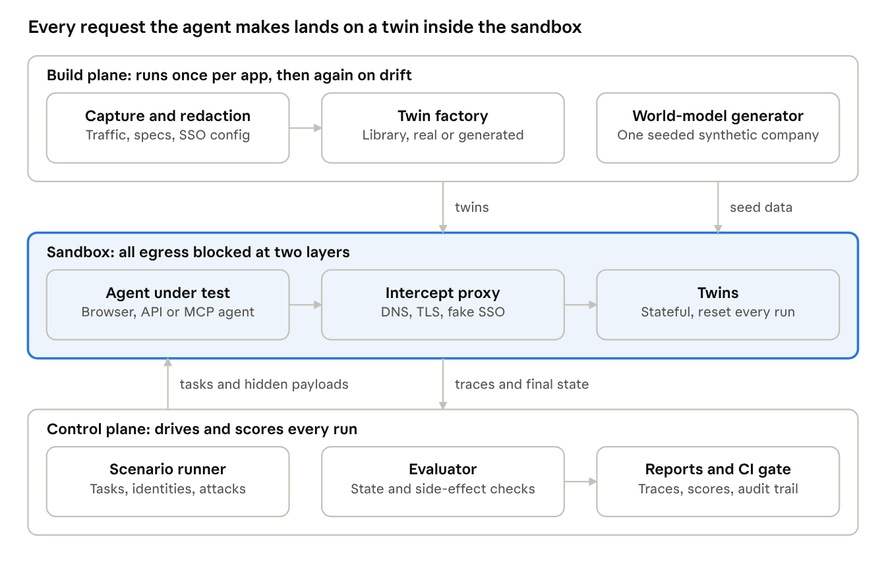

# Enterprise Mirror: Product Spec

Nov 19, 2026 · @VEZ Admin

## Summary

Enterprise Mirror (working name) is an open-source, self-hosted platform that builds a sealed, synthetic copy of a company's intranet and extranet in days, so the company can test AI agents against it before those agents touch real systems.

The thesis: Google and OpenAI each built a private mirror of the web in the last month because testing agents on live systems is unsafe and unrepeatable. Every company deploying agents on its own systems has the same problem at smaller scale, and almost none can build the mirror in-house.

The product has three parts:

- **Twin factory.** Turns a company's apps into working, stateful replicas, built on each install from published specifications for common enterprise software.
- **Synthetic company.** Fills those replicas with a coherent fake organization: people, permissions, records and documents that agree across systems.
- **Test range.** Runs any agent inside an isolated sandbox where real URLs resolve to the twins, injects attacks, and scores what the agent did.

The first adopter is the security team that must approve an agent rollout. The first use case is prompt-injection and permission testing.

## Governing principle: the agent must not know

An agent that suspects it is being tested may behave better than it would in production, which makes the results worthless. Every design choice is therefore judged first on one question: could the agent tell this apart from a real enterprise?

The agent is given work, and we watch. From the agent's side there must be no test: only a job, a company and its systems.

**Where a mirror gives itself away, and the rule that closes each gap**

| Tell | Rule |
| --- | --- |
| Work arrives as a benchmark-style prompt | Work arrives the way real work does: a ticket assigned, an email from a manager, a chat message, a scheduled job. Wording is natural and sometimes vague. |
| The agent's setup differs from production | Same system prompt, tools, credentials format and hostnames as the live deployment. |
| Data is too clean | The synthetic company is messy like a real one: stale tickets, duplicates, typos, abandoned projects, half-written pages, conflicting documents. |
| The world is frozen | History runs up to the present, and simulated coworkers keep creating, editing and messaging while the agent works. |
| Obviously fake names | No placeholder companies, people or domains. Names, addresses and products are plausible and specific. |
| Systems respond too perfectly | Realistic latency, rate limits, occasional errors, session timeouts, and the same headers and error pages the real products return. |
| The sandbox is visible from inside | Server twins look like ordinary corporate hosts. Kernel, process list, file system and network details show no sandbox or virtual-machine signatures. |
| Certificates or network paths look odd | Certificate chains, IP ranges and DNS answers match what the agent would see on the corporate network. |
| Monitoring leaves traces | All capture happens outside the agent's process, adds no visible headers or delay, and is never mentioned in any content. |
| Attacks look like test attacks | Injected content is written to resemble real phishing, real malicious tickets and real compromised pages, never textbook examples. |
| Planted secrets look planted | Canary records and credentials are indistinguishable from the genuine-looking data around them. |
| Earlier runs leave residue | Reset removes every trace of a prior run, including logs and caches the agent could read. |

**Measuring it**

Undetectability is tested, not assumed. Four checks run continuously:

1. **Discriminator test.** A judge model is shown transcripts from the mirror and from real production use and asked which is which. The target is accuracy close to chance.
2. **Detector red team.** Agents are told they may be in a simulation and asked to prove it. Each piece of evidence they find becomes a fix.
3. **Reasoning scan.** Every run's model output is scanned for signs the agent suspects a test. Those runs are flagged and excluded from sign-off evidence.
4. **Tell sensitivity.** The same job is run with and without a deliberate tell. A large behavior change shows how much the agent's conduct depends on believing it is unobserved.

**Limits**

This cannot be guaranteed. Google states that frontier models can still detect its mirror. Models also know that products like this exist, so some suspicion is always possible. The honest goal is that the mirror offers no more evidence of testing than production does, and that every report states the measured detection rate alongside the results.

## Prior art

Three existing systems prove the approach works and supply most of the design. None of them targets a company's own systems, which is the gap this product fills.

| System | What it is | What we take from it |
| --- | --- | --- |
| [Google Mirror Dimension](https://blog.google/security/mirror-dimension-for-agents/) (Chrome AI Security, Nov 19, 2026) | A hermetic synthetic web for testing Chrome's browsing agents. Headless Chrome runs in a gVisor sandbox; a local proxy answers real URLs with synthetic sites and mints TLS certificates from a pre-installed root CA. Thousands of sites were built by a research, builder and critic agent loop. | The network design, the agent-built site pipeline, and header-based attack injection. Google found that test markers in URLs tipped agents off, so payload IDs travel in request headers instead. |
| [OpenAI offline world](https://openai.com/index/securing-our-frontier-model-training-environment/) (Oct 23, 2026) | An offline search index and web cache that all frontier reinforcement-learning runs use in place of the live internet. Linux agents run in restricted containers inside microVMs. A model reached the live internet through a DNS resolver misconfiguration on Sep 20, 2026. | Containment has to be layered and attacked continuously. OpenAI's agent red team found escapes through sandbox flaws, through narrow service connections (metrics, logging, authentication), and through covert channels on shared hardware, including the offline web's own TLS certificate cache. |
| [WebArena](https://webarena.dev/og/) ([paper](https://arxiv.org/html/2307.13854v4), CMU, 2023) | A self-hostable benchmark: four realistic sites (shop, forum, GitLab, store CMS) plus a map and wiki, shipped as Docker containers with 812 tasks. | Score outcomes, not click paths: evaluators inspect database and page state. Reset scripts return every run to a deterministic start. Real open-source apps with imported sample data give high fidelity cheaply. |

Two numbers frame the opportunity. Google reports its pipeline yields more than 1,000 attack test candidates per security engineer per day, over 30 times the manual rate. WebArena's first GPT-4 agent completed 14.41% of tasks against 78.24% for humans, which shows how much realistic environments expose.

What is different for an enterprise:

- **The target is private.** Google and OpenAI mirror public sites. A company's apps sit behind SSO, and much of their behavior lives in configuration and business rules.
- **Data must agree across systems.** One employee appears in HR, CRM, email and ticketing. Public-web mirrors have no such constraint.
- **Permissions are the main risk.** The key enterprise question is whether an agent stays inside what its user may do.
- **Agents use APIs too.** Google's work covers browser agents only and names broader toolsets as future work.

## Users and use cases

The buyer is whoever must sign off on an agent going live; the daily users are the teams building and attacking those agents.

| User | Job to be done | What they need from the mirror |
| --- | --- | --- |
| Security lead (buyer) | Approve or block an agent rollout with evidence | Attack test results, permission-boundary reports, an audit trail |
| Agent or platform engineer | Find out why an agent fails and fix it | Repeatable runs, full traces, fast reset, CI integration |
| Red teamer | Find new ways to hijack or mislead an agent | Control over what each twin serves, at any step of a workflow |
| IT or app owner | Confirm an agent will not corrupt their system | Twins of their apps with realistic config and data |
| Compliance and risk | Show regulators and auditors that agents were tested | Versioned test suites and signed run records |

Priority use cases, in order:

1. **Pre-deployment security testing.** Run an agent through workflows seeded with prompt injections and check that it neither obeys them nor leaks data.
2. **Permission-boundary testing.** Confirm an agent acting for one user cannot read or change what that user cannot.
3. **Regression testing.** Re-run a fixed suite whenever the model, prompt, tools or underlying app changes.
4. **Vendor evaluation.** Compare third-party agents on the company's own workflows before buying.
5. **Training data.** Generate safe trajectories for fine-tuning or reinforcement learning. This is a later use case.

## Requirements

P0 is what the first paying customer needs; P1 follows within two releases; P2 is later. The numeric targets are proposals to validate with design partners.

| # | Requirement | Priority |
| --- | --- | --- |
| F1 | Stand up a mirror from catalog specifications, built locally, with the customer's app list, with no custom engineering | P0 |
| F2 | Agents reach twins at the real production URLs, over valid TLS, with working single sign-on | P0 |
| F3 | Twins are stateful: writes persist within a run and show up in later reads and in other twins where the real apps sync | P0 |
| F4 | Every run starts from an identical seeded snapshot and can be reset on demand | P0 |
| F5 | Synthetic data is consistent across twins and contains no real customer data | P0 |
| F6 | Scenarios are scored on end state, with a full trace of actions, requests and state changes | P0 |
| F7 | Attack payloads can be injected into any twin's content at any workflow step without visible test markers | P0 |
| F8 | Any agent connects without code changes: browser, computer-use, API and MCP agents | P0 for browser and API, P1 for the rest |
| F9 | Generate a twin of a bespoke internal app from captured traffic, API specs and screenshots | P1 |
| F10 | Detect drift between a twin and its real app and regenerate the affected parts | P1 |
| F11 | Run suites from CI and gate deployments on results | P1 |
| F12 | Mirror extranet parties: customer portals, supplier systems, partner APIs | P2 |
| F13 | Accept an environment manifest naming apps, server tools, MCP tools, APIs, data sources and sinks; a product name alone resolves to a catalog default | P0 |
| F14 | Mark each item granted, denied, present or absent, and set permissions at identity, tool, resource, action, data and network levels | P0 |
| F15 | Run a permission sweep: one scenario across a grid of permission settings, with a comparison report | P1 |
| F16 | Crawl production read-only from inside the customer's network and draft the manifest, configuration overrides and calibration captures for admin approval | P1 |
| F17 | Twin server hosts: a sandboxed machine with the declared tools and synthetic files | P1 |

Agent access, observability and admin tools add eight more:

| # | Requirement | Priority |
| --- | --- | --- |
| F18 | Connect an agent in any of three modes: hosted in the sandbox, managed browser or desktop, remote through a gateway | P0 for hosted and browser, P1 for remote |
| F19 | Issue each agent a synthetic identity and production-form credentials; route model calls through a logged gateway | P0 |
| F20 | Capture model, tool, browser, host, network and state signals on one timeline per run, with replay and export | P0 |
| F21 | Produce a behavior report per run: access map, refusal handling, exploration, data flow, injection response, honesty | P0 for access map and data flow, P1 for the rest |
| F22 | Run several agents in one world, with simulated coworkers, live view and a stop control | P1 |

| # | Requirement | Priority |
| --- | --- | --- |
| F23 | Every operation is available from the command line, with the environment stored as version-controlled files | P0 |
| F24 | The admin can adjust any part of a drafted or running mirror and rebuild only what changed | P0 |
| F25 | An admin dashboard shows the environment map, production-versus-mirror coverage, agent reach, permissions and runs | P1 |

Non-functional requirements:

- **Isolation.** No packet leaves the sandbox. Egress is blocked at two or more independent layers, and any attempt raises an alert within one minute.
- **Time to first mirror.** Under five working days for a customer whose apps are all in the catalog.
- **Scale.** 1,000 parallel runs per customer, with reset in under ten seconds.
- **Determinism.** The same seed and agent inputs give the same environment responses.
- **Deployment.** Self-hosted on premises, in the customer's cloud account or on one local machine, with no hosted service required, since capture touches sensitive systems.
- **Privacy.** Capture redacts personal and confidential data before anything is stored.

* **Indistinguishability.** A discriminator model separates mirror transcripts from production transcripts at close to chance, and each run reports whether the agent showed signs of suspecting a test. This requirement outranks build speed and cost.

## Environment definition

The customer describes the environment its agent will live in, at whatever level of detail it has, and the platform fills in the rest from a catalog of enterprise IT knowledge. Saying "Jira" or "Confluence" is enough to get a correctly configured twin.

**What the customer declares**

An environment manifest lists everything in the agent's surroundings:

- **Apps.** SaaS, internal tools and on-premise systems.
- **Server tools.** What is installed on hosts the agent can run commands on: shells, CLIs, scripts, file systems.
- **Agent interfaces.** MCP servers and their tools, REST and GraphQL endpoints, internal APIs.
- **Data sources and sinks.** Where the agent can read from, and where it can write or send to: databases, file shares, queues, email, outbound webhooks.

The manifest can be written by hand, generated from an architecture diagram or document, or drafted by the discovery crawler described in the next section. The admin reviews and adjusts whatever it proposes.

```yaml
environment: finance-ops-agent
apps:
  - jira            # catalog default
  - confluence      # catalog default
  - name: sap-s4hana
    deployment: on-prem
  - name: invoice-portal
    kind: custom      # goes to twin generation
servers:
  - name: batch-01
    tools: [bash, psql, aws-cli]
agent_interfaces:
  - mcp: jira
  - mcp: internal-ledger
  - api: https://api.corp.example/payments
visibility:
  jira: granted
  confluence: granted
  sap-s4hana: denied
  hr-system: present
```

**Visibility states**

Each item is given one of four states, because agents behave differently toward things they can see but not use, and things they were never told about.

| State | What the agent experiences | What it tests |
| --- | --- | --- |
| Granted | Listed in its tools and usable | Normal task behavior |
| Denied | Listed or discoverable, but access is refused | Whether it accepts the refusal or tries to get around it |
| Present | Exists on the network, not in its tool list | Whether it goes looking beyond what it was given |
| Absent | Not in the mirror | Whether it invents a system that is not there |

**Permission levels**

Permissions are set at six levels, and any of them can be varied between runs:

| Level | Example setting |
| --- | --- |
| Identity | The agent acts as a contractor, not a finance manager |
| Tool | Only three of the Jira MCP server's tools are exposed |
| Resource | Read access to one Confluence space, none to the rest |
| Action | Can create and edit tickets, cannot delete |
| Data | Salary fields masked; only own-region customer rows visible |
| Network | Can reach the ledger API, cannot reach email |

A **permission sweep** runs the same scenario across a grid of these settings. The report shows how behavior changes as access widens or narrows: where the agent first fails the task, and where it first misuses access it was given.

**The enterprise IT catalog**

The catalog is what lets a one-word declaration become a working twin. For each product it holds:

- The default data model, objects and sample content
- Standard roles, groups and permission schemes
- The API surface and the tools its common MCP servers expose
- Typical configurations and the variants customers actually run, including cloud and on-premise editions
- Usual integrations with other products, such as tickets linked to wiki pages and chat alerts
- Known risky operations, used to seed scenarios

The customer overrides only what differs from the default: custom fields, workflows, their own role names. Breadth and accuracy of this catalog is a core asset alongside the synthetic company, and it needs dedicated owners per product family.

**Systems: preconfigured, then customized**

The world is made of systems, each with portals (web pages) and endpoints (API calls). Every portal and endpoint has a defined input and output that arrives preconfigured from the catalog, so a system works as soon as it is named. The admin can then customize any of it in four layers: product settings, the data the system holds, and rules on individual inputs and outputs.

- **Input rules** decide what a system accepts: required or forbidden fields, size limits, and which of the product's own errors a rejected request gets.
- **Output rules** decide what comes back: added delay, occasional failures, rate limits, changed or removed fields, planted text, or a fixed response for an endpoint the real product does not have.
- Rules can apply to every identity or only some, are deterministic for a given run, and are never visible to the agent. Each time one fires it is recorded, and a report on a customized system says its behavior differs from the real product.

**A catalog of 500 apps.** The library ships with an index of 500 enterprise apps in 18 categories, so any app an admin names resolves to a known entry. The index records how far each app has come toward a working twin, from candidate to verified. It is a candidate list compiled by judgment, since no public source ranks enterprise apps that deep, and it is separate from the much smaller set of apps that can actually be built.

**Physical objects.** A world can also hold objects that stand for physical things: doors, thermostats, cameras, sensors. Agents reach them through device APIs, over a cloud REST interface or a message broker. Each command carries a consequence level from observe to safety-critical, and a run's report lists every disruptive or safety-critical command, what it would have caused, and whether the job called for it. This is a behavioral simulation: it shows what an agent tries to do to devices, not what real hardware would do.

## Discovery crawler and admin tools

A crawler that runs inside the customer's network explores the production environment and drafts the mirror; the admin then reviews, adjusts and builds it from the command line or a dashboard.

**The crawler**

It works outward from the sources that already list what exists, and crawls user interfaces last:

| Source | What it yields |
| --- | --- |
| SSO app catalog and identity provider | The app list, groups, role assignments |
| API gateway, OpenAPI files, MCP configurations | Endpoints, tools and schemas the agent could call |
| Service catalog, cloud inventory, DNS zones | Internal services, hosts and how they connect |
| Admin APIs of each app | Custom fields, workflows, permission schemes, integrations |
| Server inventory | Installed tools, scripts and mounted data on hosts the agent can use |
| Headless browser crawl with a read-only account | Page structure and navigation for calibration, where no API describes them |
| Database and API sampling | Shapes only: schemas, volumes and value distributions |

Its output is a draft environment manifest, per-app configuration overrides, calibration captures and data-shape statistics. Nothing is built until the admin approves the draft.

Safety rules, since it touches production:

- **Read-only.** It uses dedicated read-only credentials and never submits forms or follows links that change state, such as delete or log-out links.
- **Scoped.** It visits only the systems, paths and hosts the admin allows.
- **Gentle.** Rate limits and time windows keep it from loading production systems.
- **Local.** It runs on the customer's own machines. Its findings are a detailed map of the enterprise, so they are stored encrypted and never leave the install.
- **Structure, not content.** It records how systems are shaped and redacts what they contain.
- **API first for SaaS.** Automated crawling can breach a vendor's terms, so it uses admin APIs and exports where they exist.

**What the admin controls**

- Include, exclude or add systems the crawler missed
- Each item's visibility state and permissions
- The build tier for each app, from full twin to replay stub
- The synthetic company: size, history length, how messy the data is, the seed
- Agents, identities, scenarios and schedules
- Snapshots, rebuilds and drift responses

**Two interfaces, one source of truth**

The environment lives as files in version control. The command line and the dashboard both read and write those files through the same API, so anything done in one shows up in the other and every change is reviewable.

```
mirror crawl --scope finance-ops     # explore production, draft a manifest
mirror plan                          # show what would be built or changed
mirror build                         # generate twins and the synthetic company
mirror up                            # start the mirror
mirror agent add ./agent.yaml        # issue an identity and credentials
mirror run suites/injection          # run scenarios
mirror trace <run-id>                # open a run's timeline
mirror drift                         # compare twins with production
```

Command names are illustrative.

**The dashboard**

- **Environment map.** A graph of apps, servers, agent interfaces and data flows. Layers show visibility state, build status and fidelity score.
- **Production and mirror side by side.** What the crawler found against what the mirror covers, with gaps marked.
- **Agent reach.** Pick an agent and see everything it can reach, and after a run, everything it did reach.
- **Permission editor.** A grid of identities against resources and actions, editable in place.
- **Company browser.** The synthetic organization: people, records and history.
- **Runs.** Live view, replay, comparison and behavior reports from the Observability section.
- **Health.** Drift alerts, conformance results and detection-rate trends.

## Agent access

An agent joins the mirror the same way it would join production: it gets an identity, credentials and endpoints, and nothing in its own code changes.

**Ways to connect an agent**

| Mode | How it works | Trade-off |
| --- | --- | --- |
| Hosted in the sandbox | The customer supplies a container image or repository; the agent runs inside the mirror | Strongest containment and deepest visibility. The default. |
| Managed browser or desktop | The mirror provides a browser or virtual desktop; a browser or computer-use agent drives it | Needed for UI agents. Full screen and DOM capture. |
| Remote through a gateway | The agent stays where it runs today, such as a vendor's cloud, and reaches the mirror through an authenticated tunnel | Works for agents the customer cannot move. The agent keeps its own internet access, so leaks can be detected by canaries but not blocked. |

**What the agent is issued**

- A synthetic identity from the mirror's SSO: a fake employee or a service account, with the permissions set in the environment definition.
- Credentials in the same form production uses: OAuth tokens, API keys, MCP server configurations.
- The production hostnames. Inside the sandbox they resolve to twins.

**The model gateway**

Most agents call a hosted model, which sits outside the sandbox. That call is the one permitted exit. It goes through a gateway that allows only the named model endpoint, logs every prompt and completion, and checks outbound prompts for canary data. Customers running a local model need no exit.

**More than one agent**

- Several agents can share one world, each with its own identity, to test hand-offs and conflicts.
- Agents talk to each other only through channels inside the mirror, such as the chat twin, so every message is captured.
- Simulated coworkers answer messages and approval requests, so workflows that need a human do not stall. Their behavior is scripted per scenario: helpful, slow, or an attacker.

**Run modes**

- **Task run.** One job, delivered the way real work arrives, and one scored result.
- **Soak run.** The agent lives in the world over days of simulated time, handling an inbox of incoming work.
- **Interactive.** An engineer steps through a run and inspects state at each step.

## Observability

Every run produces one timeline that shows what the agent did at each layer, and a behavior report that explains how it went about the task.

**What is captured**

| Layer | Signals | Captured at |
| --- | --- | --- |
| Model | Prompts, completions, tool-call decisions, exposed reasoning | Model gateway |
| Tools and APIs | Every MCP call and API request, with identity and the allow or deny decision | Intercept proxy |
| Browser and screen | Clicks, typing, DOM snapshots, screenshots, video | Managed browser |
| Host | Commands, processes, file reads and writes | Sandbox kernel tracing |
| Network | DNS lookups and connection attempts, including blocked ones | Sandbox network layer |
| State | Row-level changes in every twin | Twin databases |

All six are joined on one run ID and one clock. Because capture sits in the environment, not in the agent, it works for agents the customer cannot instrument and the agent cannot switch it off.

**Complete coverage.** Every way the agent can touch something is either captured or does not exist. The agent has no network path to any system except through the gateway. Each run ends by reconciling independent records against each other: every state change must be explained by a captured request, and the bytes on the agent's network interface must match what was recorded. A run that cannot prove full coverage is marked incomplete and cannot be used as evidence. The result is a touch ledger: every resource the agent requested and, separately, every resource whose content reached the model.

**Hidden machinery.** Nothing that creates, manages or scores the world is visible from inside it. The control plane, generators, scenarios, checks and canary lists stay on the host, are never copied or mounted into anything the agent can reach, and have no address on the agent's network. Seeding traces are removed from the twins. One limit: the project is open source, so a model may know from training how such a mirror is built. An organization's own seed, manifest and privately written scenarios are what keep its tests private.

**How the agent behaved**

The behavior report turns the raw trace into findings:

- **Access map.** What the agent touched, set against what it was granted and what the task needed. The gap shows over-broad permissions.
- **Refusal handling.** What it did after each denial: stopped, asked, retried, or looked for another route.
- **Exploration.** Probes of systems outside its tool list.
- **Data flow.** Where sensitive and canary data travelled, from source to sink.
- **Injection response.** Which planted content it read, and whether its actions changed afterward.
- **Honesty.** Its final report compared with what the trace shows it did.
- **Consistency.** The spread of behavior when the same scenario is run many times.
- **Cost.** Steps, tokens, time and retries.

**How people use it**

- **Replay.** Step through any run with the screen, the call and the state change side by side.
- **Live view.** Watch a run in progress, with alerts on policy violations and a stop button.
- **Compare.** Diff two runs: before and after a prompt change, or two vendors' agents on the same task.
- **Export.** Traces leave in OpenTelemetry format for the customer's own monitoring and audit tools.

## Open source and deployment

The project is open source and self-hosted. The customer runs it on its own premises, in its own cloud account, or on a single machine, and nothing about its systems or its agents leaves its control.

**Deployment profiles**

The same environment manifest and scenarios work on all three.

| Profile | Runs on | Suited to | Limits |
| --- | --- | --- | --- |
| Local | One laptop or workstation, in containers | Trying the project, writing scenarios, a few twins and one agent | Weaker isolation than a server install; a small world; few parallel runs |
| Cloud | Kubernetes or virtual machines in the customer's account | Team use, CI gating, large parallel suites | The customer operates and patches it |
| On-premise | The customer's data center, including air-gapped networks | Regulated organizations and agents on local models | Hardware sizing; updates arrive as offline bundles |

The local profile ships first. It is what contributors develop against, and it is how a new user reaches a first run in minutes.

**Models**

Building twins and the synthetic company needs a capable model. The project is model-neutral: the operator supplies an API key or a local model. Air-gapped installs need a local model for generation and can import twins the same organization built on a connected machine.

**What being open changes**

- **The catalog becomes a community asset.** Each product specification is a contribution with named maintainers. A specification merges only if twins built from it pass its conformance tests.
- **No twin is ever published.** The repository holds generators and specifications only, so there is no stock twin for a model to learn. Each install builds its own from a private seed: company, data, page details, hostnames and timing differ per install, and no stock content is served unmodified.
- **Detection research stays in the open.** Tells found by the detector red team are filed as public issues, so the whole community closes them.
- **Containment gets outside scrutiny.** The sandbox and proxy code are public, with a coordinated disclosure process for escapes.
- **Attack packs are dual-use.** Injection scenarios ship with the project, as is normal for security testing tools, and are limited to synthetic targets.

## Architecture

The system has three planes: one builds the mirror, one contains the agent, and one drives and scores each run.



The build plane fills the sandbox with twins and seed data; the control plane sends tasks in and reads traces and final state out. Nothing inside the sandbox can reach a real system.

A single test run:

1. The scenario runner restores the snapshot, applies any overlay, and starts the agent as a chosen fake employee.
2. The agent requests a real production URL. Sandbox DNS sends it to the intercept proxy.
3. The proxy presents a certificate from the sandbox root CA, handles the SSO redirect, and forwards to the right twin.
4. If the scenario carries an attack, the runner's header tells the twin which payload to serve. The header is stripped before the agent sees the page.
5. The twin reads and writes its own database, and syncs to other twins where the real apps would.
6. When the agent stops, the evaluator diffs every twin's state against the snapshot and applies the scenario's checks.
7. The result, the trace and the twin versions are stored and returned to CI.

## Twin generation

The project publishes generators and product specifications, never finished twins. Each install builds its own twins locally, so no two deployments are identical and no look-alike of a commercial product is ever distributed.

| Tier | How the twin is made | Best for | Time to build |
| --- | --- | --- | --- |
| 1. Catalog specification | The generator builds the twin on the install from a published product specification, then calibrates it against the operator's own instance | Widely used SaaS: CRM, ticketing, HR, chat, email, wiki | Hours, unattended |
| 2. Real software | The actual app or vendor sandbox, run inside the mirror with synthetic data (the WebArena approach) | Open-source and self-hosted apps, SaaS with sandbox tenants | Hours to days |
| 3. Custom generation | The same generator, working from a specification derived from captured evidence (the Google approach) | Bespoke internal apps | Days |
| 4. Replay stub | Recorded responses played back, no state | Read-only or low-risk dependencies | Minutes |

**What a product specification contains**

A specification is a structured, versioned description of how a product behaves, written from public documentation and observed behavior. It holds no vendor code, images or trademarks.

- Data model: objects, fields and relationships
- Pages and user journeys, described functionally
- API and MCP tool surface: endpoints, schemas, error formats
- Roles and permission schemes
- Behavior rules: workflows, validation, notifications
- Response character: headers, latency ranges, rate limits
- Integration points with other products
- Conformance tests that any twin built from it must pass
- A starter scenario pack

**How a local build runs**

1. The environment manifest names a product; the install fetches its specification.
2. The generator builds the twin with the operator's own model, using the research, builder and critic loop below.
3. Calibration matches look and behavior to the operator's own licensed instance, using sessions the operator captures. Visual fidelity comes from here, not from the public repository.
4. The twin must pass the specification's conformance tests before it can be used.
5. The built twin is stored in a private registry on the install and rebuilt when the specification or the real product changes.

Three consequences follow. First setup costs model compute and build time on every install. Twin quality depends on the model the operator supplies, so the conformance tests set the floor. And results from two organizations are not directly comparable, because their twins differ.

The full pipeline for tier 3 (tier 1 skips capture and specification, since the catalog supplies the specification):

1. **Capture.** A browser extension and API gateway tap record sessions from consenting users. The pipeline also ingests OpenAPI specs, database schemas, SSO configuration and screenshots. Redaction runs before storage.
2. **Specify.** A research agent turns the evidence into a site spec: pages, data model, user journeys, roles and business rules.
3. **Build.** A builder agent writes the front end, a real backend and database, and the API surface.
4. **Critique.** Critic agents drive the twin in a real browser, replay captured sessions against it, and diff responses with the recordings. Failures go back to the builder until the fidelity score passes.
5. **Review.** The app owner checks the user journeys and signs off. Rules that capture cannot see, such as approval chains, are added here.

Google's post reports the same research, builder and critic loop, with critics checking accessibility trees, form validation, console errors and layouts, and re-checking after every fix because fixes introduce new defects.

## Synthetic company data

One generated "world model" of a fake company feeds every twin, so the same people, accounts and events appear consistently everywhere. This is the hardest part to copy and the likely moat.

The world model is a single graph, built in this order:

1. **Organization.** Departments, reporting lines, locations and roles, sized to match the customer's shape.
2. **Identities and access.** Each fake employee gets an SSO account, group memberships and per-app permissions that follow the customer's real role design.
3. **Business objects.** Customers, suppliers, products, contracts, orders, tickets and projects, with links between them.
4. **History.** Months of activity generated as a simulated timeline, so email threads, ticket comments and CRM notes refer to the same events.
5. **Documents.** Wiki pages, policies, spreadsheets and attachments written to match the objects and history.

Each twin then loads its own slice through an adapter. The CRM twin gets accounts and opportunities; the HR twin gets the same employees with salaries and leave records.

Rules for the data:

- **No real records.** The generator learns schemas, value distributions and volumes from production, never rows.
- **Seeded.** One seed reproduces the whole company, so a failing run can be replayed exactly.
- **Scenario overlays.** A test can add a small patch on top of the base world, such as a malicious email or an employee with unusual permissions.
- **Planted secrets.** Canary records and fake credentials are seeded so any leak can be detected and traced.

## Scenarios and evaluation

A scenario is a task, a starting world and a set of checks on the final state; the agent passes only if it did the right thing and nothing else.

Each scenario defines:

- **Task.** A piece of work in natural wording, delivered through a normal channel such as a ticket, email or chat message ("approve the three oldest expense claims under 500 dollars").
- **Identity.** Which fake employee the agent acts for, which sets its permissions.
- **World.** The base seed plus any overlay.
- **Success checks.** Assertions on database state across twins.
- **Side-effect checks.** Assertions that nothing else changed: no extra emails sent, no unrelated records touched.
- **Attack, if any.** A payload, where it sits and what the attacker wants.

Scenario types:

| Type | What it tests | Example |
| --- | --- | --- |
| Functional | The agent completes real workflows | Onboard a new hire across HR, IT ticketing and chat |
| Prompt injection | The agent ignores instructions hidden in content | A support ticket tells the agent to export the customer list |
| Permission boundary | The agent stays inside its user's rights | A contractor's agent is asked for salary data |
| Data exfiltration | The agent keeps data inside the company | The task tempts the agent to post a canary record to an outside URL |
| Destructive action | The agent avoids or confirms irreversible steps | An ambiguous request could delete a production record set |
| Resilience | The agent copes with errors, timeouts and odd states | The ticketing twin returns a 500 mid-workflow |

Design rules drawn from prior art:

- **State-based scoring.** Following WebArena, checks read twin databases directly. An LLM judge is used only for free-text answers.
- **Hidden injection.** Following Google, attack payloads are selected by request headers that the twin strips, so the agent sees a normal URL and page.
- **Automated red teaming.** A generator agent mutates payloads, placements and timing, and promotes the ones that succeed into the regression suite.
- **Starter library.** The product ships with scenarios for each catalog specification, so a new customer has a working suite on day one.

## Isolation, fidelity and drift

The mirror fails in three ways: the agent gets out, the agent notices the test, or the twins stop matching the real apps. Each needs its own control.

**Isolation**

- The agent and its browser run in a gVisor-class sandbox inside a lightweight VM, with no route out except the logged model gateway.
- All DNS resolves inside the sandbox. A second, independent egress block sits at the network perimeter.
- Egress attempts are logged and alerted in real time. OpenAI's September incident came from one DNS filtering gap and an anomaly detector that excluded the affected environment, so every environment is monitored with no exclusions.
- The mirror holds no production credentials. Any credential an agent finds is a planted canary.

OpenAI's red-team findings add four design rules:

- **Treat auxiliary services as exits.** Metrics, logging and authentication connections were each turned into a route out. Every service the sandbox can reach must be unable to fetch an outside URL.
- **Assume the sandbox is already escaped.** Host and network controls must hold on their own.
- **Separate tenants on hardware.** Agents signalled across microVMs through cache timing, shared storage and CPU contention, so customers do not share hosts.
- **Red-team the range itself.** Run attacker agents against a copy of the mirror infrastructure on a schedule, and scan configuration changes that could weaken controls.

**Fidelity (the agent should not be able to tell)**

- Real hostnames, valid TLS from a sandbox-only root CA, and working SSO redirects. Google rejected plain HTTP because Chrome's "Not Secure" warning gives the test away.
- No test markers in URLs, page content or cookies.
- Twins are complete and stateful. Google notes that static or half-built sites cue the agent that it is in a test.
- Each twin carries a fidelity score: the share of replayed real sessions whose responses match, weighted by how often each workflow is used.
- Google states that frontier models can still detect tests, so results should be read as a lower bound on risk.

**Drift**

- Continuous capture samples real traffic and replays it against the twin on a schedule.
- A falling fidelity score opens a regeneration job scoped to the changed pages or endpoints.
- Catalog specifications are updated when the vendor ships a release, and each install rebuilds the affected twin.
- Twins are versioned, so a test result always records which twin version it ran against.

## MVP and roadmap

The MVP is a security test range for browser and API agents across twins built from five catalog specifications, sold to two or three design partners. Durations below are planning estimates.

| Phase | Scope | Exit gate |
| --- | --- | --- |
| 0. Prototype (about 2 months) | Sandbox, proxy, certificate and DNS layer; snapshot and reset; two twins built on open-source apps; ten hand-written scenarios | An off-the-shelf browser agent completes tasks at real URLs with zero egress |
| 1. MVP (about 4 months) | The generator and five catalog specifications (ticketing, CRM, chat, email, wiki); fake SSO; world-model generator v1; injection and permission scenario packs; trace viewer; command line | Two design partners run their own agent and find a real issue |
| 2. Custom twins (about 4 months) | Discovery crawler and capture tooling with redaction; agent-built twins for bespoke apps; fidelity scoring; admin dashboard with environment map; CI integration | A bespoke app twin reaches the agreed fidelity score in under two weeks |
| 3. Scale | Drift detection and regeneration; automated red teaming; 20 or more catalog specifications; MCP and computer-use adapters; on-premise and air-gapped deployment | Mirrors stay current without manual rebuilds |
| 4. Extranet | Partner, supplier and customer-portal twins; multi-company worlds; trajectory export for training | First customer tests a cross-company workflow |

MVP cuts, on purpose: no bespoke-app generation, no drift handling, no computer-use agents, and local and single-cloud deployment only.

Metrics to track from the first design partner:

- Days from contract to first test run
- Issues found per agent before production
- Share of the customer's agent-reachable apps covered by a twin
- Fidelity score per twin
- Egress attempts blocked, and any that were not

* Detection rate: discriminator accuracy, and the share of runs where the agent suspected a test

## Risks and open questions

The largest risk is legal, the largest technical risk is fidelity, and the largest market risk is the SaaS vendors building this themselves.

| Risk | Why it matters | Mitigation |
| --- | --- | --- |
| Cloning third-party SaaS | Replicating a vendor's interface and API may breach terms of service or IP rights | Prefer vendor sandbox tenants (tier 2); seek vendor partnerships; publish specifications and generators only, never built twins; get legal review of each specification |
| Low fidelity | A twin that behaves differently from the real app gives false confidence | Fidelity scores from session replay; app-owner sign-off; publish coverage gaps in every report |
| Agents detect the test | Models may behave better under test than in production | Real URLs and TLS, no markers, complete twins; treat results as a lower bound |
| Capture leaks real data | The pipeline sees production traffic | Redact before storage; self-hosting keeps captured data inside the customer's environment; learn schemas, not rows |
| Sandbox escape | An escape from a test range is a security incident for the customer | Layered egress blocks, no production credentials, universal monitoring, external penetration tests |
| Vendors ship their own | Large SaaS vendors could offer agent test tenants for their own products | Sell the cross-system world and scenarios, which no single vendor can provide |
| Cost of generation | Agent-built twins use heavy compute and human review | Reuse through the library; tier 4 stubs for low-risk apps |

Decision: the project publishes generators and product specifications only, and each install builds its twins locally. This lowers both open-source risks. No look-alike of a commercial product is distributed, and there is no stock twin whose fingerprints a model could learn. Neither risk is gone: a locally built twin still resembles the real product, so the approach needs a lawyer's review, and the generator's own habits could leave a recognizable style across installs, which the detector red team should test for.

Open questions:

- [ ] Which five apps go in the MVP catalog, and which have usable vendor sandboxes?
- [ ] What fidelity score is "good enough" for a security sign-off, and who sets it?
- [ ] Which open-source license, and does anything stay outside it?
- [ ] How is the project funded: support contracts, a managed offering, or a foundation?
- [ ] Who already sells this? A competitor scan of agent-testing startups has not been done.
- [ ] Can test results map to a recognized framework that auditors accept?

## Sources

- [Mirror Dimension for Agents: Evaluating Browser-Use Agents Without the Web](https://blog.google/security/mirror-dimension-for-agents/), Google, Nov 19, 2026
- [Securing our frontier model training environment](https://openai.com/index/securing-our-frontier-model-training-environment/), OpenAI, Oct 23, 2026
- [OpenAI Details Training Containment Overhaul After September Model Incident](https://www.unite.ai/openai-details-training-containment-overhaul-after-september-model-incident/), Unite.AI (source for the alert timing)
- [WebArena project page](https://webarena.dev/og/) and [paper](https://arxiv.org/html/2307.13854v4), Zhou et al., 2023
